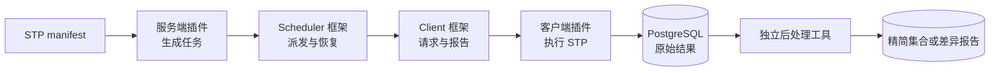

# TestTracking

TestTracking 把 STP 文件分发到多个客户端执行，并把原始结果保存到 PostgreSQL。服务端插件生成业务任务，客户端插件执行任务，独立分析脚本直接读取数据库生成覆盖率精简集合或自定义报告。



当前主要使用两个插件：

- `coverage`：客户端运行 OpenCppCoverage，`coverage_settle` 从数据库生成贪心精简集合。
- `stpcompare`：客户端分别运行新老转换程序，每份 STP 的四份 info 原始结果入库，比较方式由后续分析脚本决定。

新机器先安装不带插件的基础客户端，再从服务端分配部署方案，下载插件、程序和数据。已有机器更新时发布方案即可：当前整批及已排队批次使用旧版完成后自动切换，离线机器上线补齐最新目标。每个插件使用独立 Worker，基础 Agent 自动切换和重启 Worker；客户端主程序仍单独维护。结果展示与 DSH 原生助手集中在服务端界面。

恢复路径以 PostgreSQL 为基础。scheduler 异常退出后可恢复原 run；客户端在心跳超时前或超时后重启，都可以重新注册并领取未完成任务。前提和暂缓边界见已知限制。

## 文档

1. [需求说明](docs/需求说明.md)
2. [设计说明](docs/设计说明.md)
3. [开发说明](docs/开发说明.md)
4. [部署与运行](docs/部署与运行.md)
5. [已知限制](docs/已知限制.md)
6. [基础客户端与批量部署](docs/基础客户端与批量部署.md)
7. [部署方案与资源管理](docs/部署方案与资源管理.md)

## 构建与测试

```powershell
cmake -S . -B build/rt
cmake --build build/rt --config Debug --parallel 8
ctest --test-dir build/rt -C Debug --output-on-failure
```

详细配置和插件开发方式见 [开发说明](docs/开发说明.md)。离线环境操作见 [部署与运行](docs/部署与运行.md)。
