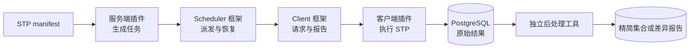

# TestTracking

TestTracking 把 STP 文件分发到多个客户端执行，并把原始结果保存到 PostgreSQL。服务端插件生成业务任务，客户端插件执行任务，独立工具在运行结束后生成覆盖率精简集合或比较报告。



当前主要使用两个插件：

- `coverage`：客户端运行 OpenCppCoverage，`coverage_settle` 从数据库生成贪心精简集合。
- `stpcompare`：客户端运行转换程序，`settle_stpcompare.ps1` 生成文本差异报告。

恢复路径以 PostgreSQL 为基础。scheduler 异常退出后可恢复原 run；客户端在心跳超时前或超时后重启，都可以重新注册并领取未完成任务。前提和暂缓边界见已知限制。

## 文档

1. [需求说明](docs/需求说明.md)
2. [设计说明](docs/设计说明.md)
3. [开发说明](docs/开发说明.md)
4. [部署与运行](docs/部署与运行.md)
5. [已知限制](docs/已知限制.md)

## 构建与测试

```powershell
cmake -S . -B build/rt
cmake --build build/rt --config Debug --parallel 8
ctest --test-dir build/rt -C Debug --output-on-failure
```

详细配置和插件开发方式见 [开发说明](docs/开发说明.md)。离线环境操作见 [部署与运行](docs/部署与运行.md)。
