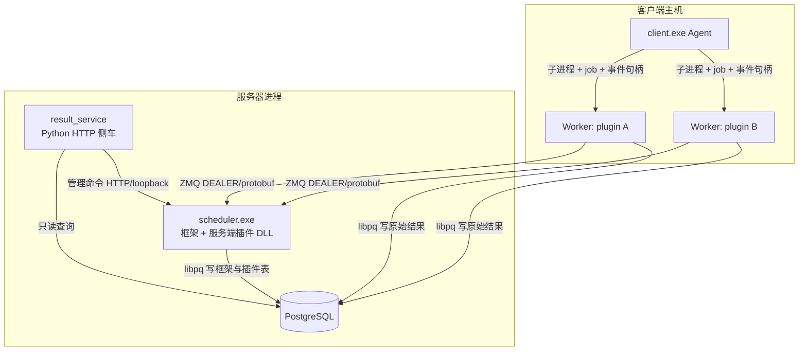
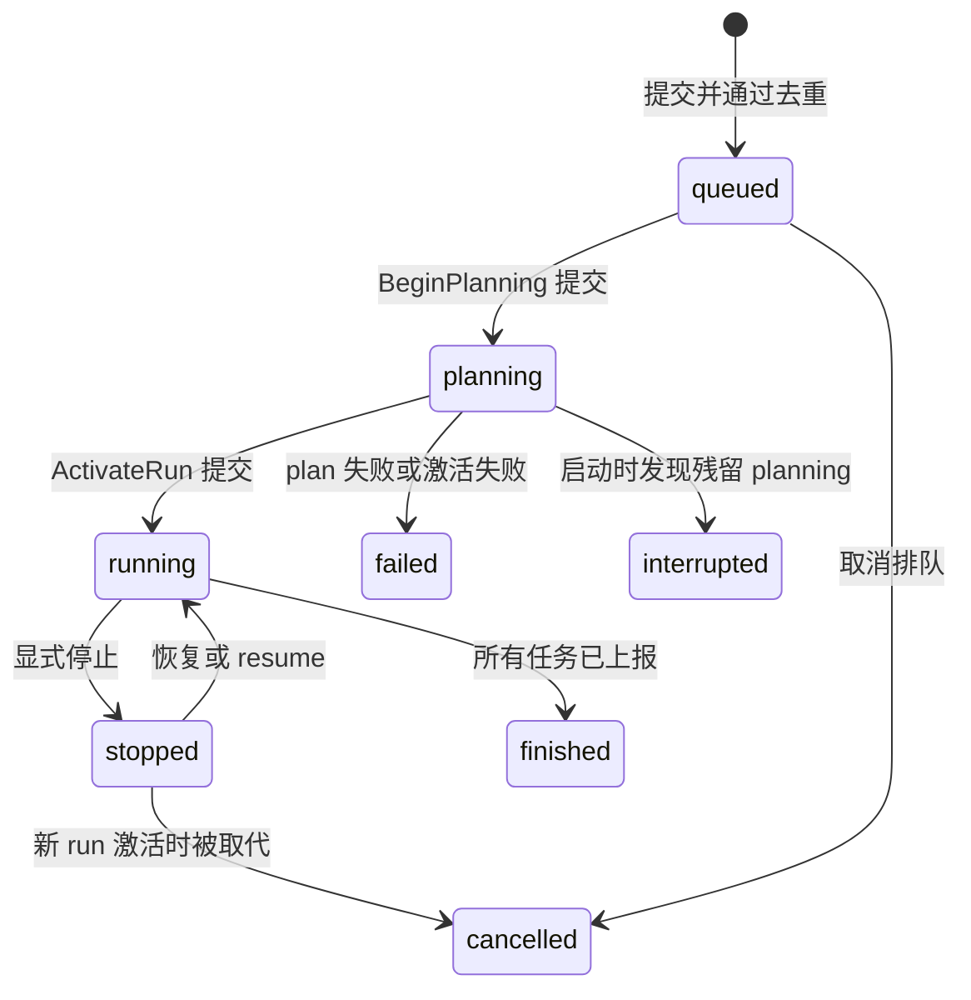
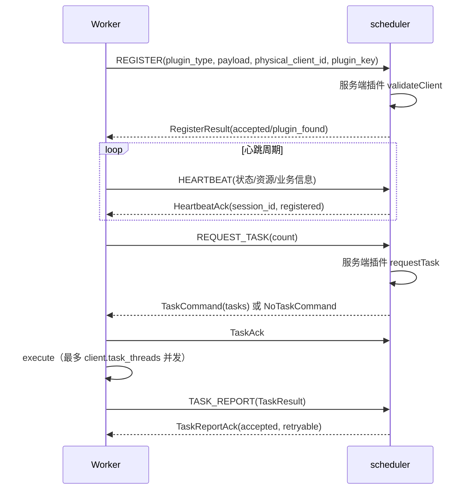
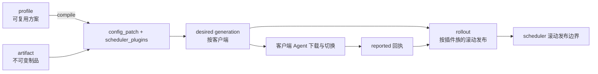

# 设计说明

本文描述 TestTracking 当前实现的模块边界、状态流转与持久化/恢复设计。约定：

- 运行前提为 Windows x64（`CMakeLists.txt`、`client/`、`scheduler/`）。
- 文中"数据库"指 PostgreSQL；框架的持久层通过 libpq 直连。
- 未实现的设计不做描述；边界见 [已知限制](已知限制.md)。

## 1. 总体结构

传输层是 ZeroMQ ROUTER（调度器）/ DEALER（客户端），消息体是 protobuf 信封 + 业务负载。框架只解释信封字段（`plugin_type`、会话、任务标识），业务负载原样透传（`common/proto/*.proto`、`common/inc/common/Protocol.h`）。

## 2. 模块边界

| 模块 | 职责 | 明确不做 | 主要文件 |
| --- | --- | --- | --- |
| `common/` | 协议信封、配置、日志、原子文件、libpq 封装、进程运行器、任务账本、插件基类 | 业务语义、任务编排 | `common/inc/common/`、`common/src/`、`common/proto/` |
| `scheduler/` | 客户端会话与物理机身份、run 队列与指纹、任务派发与租约回收、插件维护与滚动发布、本机管理 HTTP、持久化与恢复 | 执行业务程序、渲染界面 | `scheduler/src/`、`scheduler/inc/scheduler/` |
| `client/` | 注册与心跳、任务请求与执行线程池、结果上报与重试、Worker 子进程监督、调用部署代理 | 生成任务、维护 run 状态 | `client/src/Client.cpp`、`TaskExecutor.cpp`、`ProcessAgent.cpp` |
| `plugins/<name>/` | 业务：任务生成（服务端）、任务执行（客户端）、结果表、结果视图与适配器 | 框架职责 | `plugins/coverage/`、`plugins/stpcompare/`、`plugins/demo/` |
| `result_service/` | 数据库只读展示、报告脚本、制品与部署编排、调度器管理代理、DSH 助手 | 写客户端业务结果 | `result_service/app/` |
| `tools/` | 第三方构建、打包、离线部署、数据库初始化、后处理、升级代理 | 运行时逻辑 | `tools/*.ps1`、`tools/*.py` |

## 3. 调度器设计

### 3.1 线程模型

- 网络收发线程独立运行，只负责收消息与派发；
- **所有**插件调用与持久化状态操作在单一 worker 线程上串行执行，因此 FIFO 命令天然构成生命周期屏障；
- 本机管理 HTTP 把命令投递到同一条命令队列，不绕过 worker（`scheduler/inc/scheduler/Scheduler.h`、`scheduler/src/Scheduler.cpp`）。

### 3.2 run 状态机

- `planning` 跨不过激活屏障：崩溃后该 run 由启动流程统一关闭为 `interrupted`（`scheduler/src/Storage.cpp`）。
- `running` 的唯一性由 `runs` 表上的表级锁 + "同插件不得有其它 running" 校验保证（`Storage::ActivateRun`）。
- `stopped` 与 `cancelled` 的区分用于滚动发布边界：停止的旧批次可以被"恢复"或"放弃"，被取代的批次是终态。

### 3.3 管理与状态发布

- `managementStatus()` 返回快照，并附带 `snapshot_age_ms`，同时按快照年龄重算客户端 `online`，避免陈旧快照把离线机器显示为在线（`scheduler/src/SchedulerManagement.cpp`）。
- 管理命令包含 `run`、`stop`、`wakeup`、插件维护、部署应用与插件滚动发布动作；停止命令必须携带 run ID，避免陈旧页面停掉更新的 run。

### 3.4 插件维护与滚动发布

- 维护屏障：`begin_plugin_maintenance` / `end_plugin_maintenance` 期间拒绝新的 run 与资源变更。
- 滚动发布：`waiting` 阶段先冻结"旧批次边界"（boundary，记录每个未完成 run 的状态），边界内 run 结束后才允许 `activate` 切换到新目标；`switching` / `completed` / `cancelled` 是终态之外的阶段（`scheduler/src/SchedulerRollout.cpp`）。
- 边界状态持久化在与调度器配置同目录的 `<config>.rollouts.json`，原子替换写入；副作用失败的 run 状态发布按"尽力而为"处理，避免数据库已落态却把内存队头卡死（`scheduler/src/Scheduler.cpp`、`SchedulerRollout.cpp`）。

## 4. 客户端设计

### 4.1 Agent 与 Worker

- `client.exe` 不带 `--worker-plugin` 时运行 **Agent**：读基础配置，展开启用的插件列表，为每个插件启动一个独立 Worker 子进程，并用 job 对象与句柄白名单隔离；Worker 崩溃会被监督重启，Agent 负责切换与回滚（`client/src/ProcessAgent.cpp`、`client/src/main.cpp`）。
- 带 `--worker-plugin <name>` 时运行 **Worker**：注册、心跳、取任务、执行、上报。多 Worker 时 Agent 追加 `--qualify-worker-id`，Worker 身份变为 `<worker_id>/<plugin>`；单 Worker 保持历史身份 `<worker_id>`（`client/src/ProcessAgent.cpp`、`client/src/Client.cpp`）。
- 客户端配置文件里的 `worker_id` 是物理机身份；每个 Worker 用自己的传输身份注册，调度器据此把"整机"与"插件 Worker"分开记账（`common/proto/command.proto` 的 `physical_client_id` / `plugin_key`）。

### 4.2 协议时序

- 上报可重发且必须幂等；`accepted` 表示框架与插件进度都已持久化，`retryable` 表示可继续重试（`common/proto/command.proto`）。
- 客户端对取任务使用指数退避（`client.request_backoff_initial_ms` → `request_backoff_max_ms`），注册有超时与最大尝试次数（`client/src/Client.cpp`）。

### 4.3 部署代理

Agent 周期性以 `tools/client_update.ps1` 调用部署代理做"只准备"的工作（下载、校验、解包、生成不可变配置），由 Agent 决定何时 drain 并切换，注册成功后写回执。细节见 [基础客户端与批量部署](基础客户端与批量部署.md)。

## 5. 结果服务设计

- **只读侧车**：只读框架与插件的持久表，不写客户端业务结果（`result_service/README.md`、`result_service/app/repository.py`）。
- **HTTP 层**：同一端口提供界面、JSON API、报告产物与 DSH 反向代理；写入要求同源与 `Content-Type: application/json`；健康检查为 `/healthz`、`/readyz`（`result_service/app/server.py`）。
- **管理代理**：通过 `scheduler_management_url`（默认 `http://127.0.0.1:5556`）把运行命令、配置读写、插件维护与滚动发布动作转给调度器（`result_service/app/management.py`）。
- **插件资源**：每个插件在自己源码目录声明 `result_view.json`，可选 `result_adapter.py`；服务按 schema 校验并原子持久化，GET 返回 `revision`，PUT 必须带读取时的 revision，冲突返回 409（`result_service/app/views.py`、`result_service/app/plugins.py`）。
- **报告**：用户可编辑的 Python 脚本在 `report_worker.py` 内执行，返回独立交互式 HTML；每次生成使用新的 uuid 目录，失败或超时只删临时目录，旧报告保持不变（`result_service/app/reports.py`、`report_worker.py`）。
- **助手**：只支持原生 DSH。每个浏览器操作身份一个独立 DSH Web 进程，经同源代理 `/ai/dsh/<operator_id>/` 嵌入，空闲回收、并发上限；会话与工作区记录在结果服务工作目录下（`result_service/app/providers.py`、`dsh_proxy.py`）。

## 6. 部署协调设计

- **制品**：内容寻址，种类为 `plugin` / `program` / `dataset`；同 kind+name+version 不同字节返回 409，相同上传幂等（`result_service/app/artifacts.py`）。
- **方案**：`ProfileStore` 规范化 profile（插件范围、资源角色、`dry_run`、执行窗口、并发），编译为 `config_patch` 与建议的服务端 expected 字段（`result_service/app/deployment_profiles.py`）。
- **期望态与回执**：按客户端保存 desired generation 与 reported 状态，reported 必须列出当前代完整组件计划；生成换代后旧回执不会被当作当前安装（`result_service/app/deployments.py`）。
- **滚动发布**：`DeploymentRollouts` 用私有状态文件 + 私有锁推进 `pending → waiting_runs/switching → deploying → ready → completed`，取消、重试、替换与接管都有明确状态；客户端预留（reservation）由调度器强制，保证同一物理机不被并发更新（`result_service/app/deployment_rollouts.py`、`scheduler/src/SchedulerClientControl.cpp`）。
- **程序身份**：制品支撑的 coverage/stpcompare 程序版本由 `program_bindings.py` 从程序包 SHA-256、相对入口与执行设置派生，避免同名不同内容被误认为同一版本。

## 7. 持久化

| 数据 | 位置/表 | 写入方式 | 恢复语义 |
| --- | --- | --- | --- |
| run 与任务 | `runs`、`tasks`、`plugin_task_completions` | 单语句或短事务；激活用表级锁 | 启动时加载 `running`/`stopped`/`queued`；`planning` 关闭为 `interrupted` |
| 插件私有进度 | 插件自建表（如 `plugin_runs`、`plugin_run_files`、`plugin_file_outcomes`） | 插件在 `plan()`/`processResult()` 中提交 | 由插件 `restore()` 决定；不可读且不可恢复时框架以"恢复受阻"停止启动 |
| 服务端插件滚动发布边界 | `<scheduler 配置路径>.rollouts.json` | 原子替换 | 与数据库对账，边界状态以持久 run 状态为准 |
| 客户端控制与 Agent 注册 | `<scheduler 配置路径>` 同目录的客户端控制状态文件 | 原子替换 | 启动时加载；预留过期由周期维护回收 |
| 部署期望态与回执 | `deployments.json`（位于制品目录旁） | 原子替换 | 服务重启后继续；同代同内容重复写入幂等 |
| 滚动发布状态 | `deployment-rollouts.json` | 原子替换 | 服务重启后继续推进 |
| 制品 | `catalog.json` + `objects/<前两位>/<sha256>` | 原子替换 + 内容寻址 | 不可变；同内容重复上传幂等 |
| 客户端暂存与回执 | `deployments/objects`、`releases`、`active.json`、`agent_report.json` | 原子替换 | 失败锁存，需发布新修订才能重试 |

## 8. 故障恢复边界

| 场景 | 系统行为 | 恢复手段 |
| --- | --- | --- |
| 调度器崩溃（run 处于 `running`） | 重启后 `restore()` 成功则继续该 run | 保持原插件、manifest 与配置不变后重启 |
| 调度器崩溃（run 处于 `planning`） | 启动时关闭为 `interrupted` | 重新提交 |
| 配置/manifest 与 saved run 不一致 | 启动失败并给出"恢复受阻"错误，保留原进度 | 恢复原部署后重启，或按提示放弃该 run |
| 客户端离线 | 在途任务按租约/回执超时被回收并重排 | 客户端重新注册后领取剩余任务 |
| 部署下载或校验失败 | 客户端报告 `failed`，该修订被锁存 | 发布新修订；或按需清理缓存后由新修订触发重下 |
| 结果服务不可用 | 调度器继续执行与入库；`/api/status` 由管理快照提供 | 恢复结果服务；数据库结果与报告不受影响 |
| 调度器不可用 | 结果服务仍可查询数据库、生成报告、打开 DSH | 恢复调度器；部署类操作返回明确错误 |

## 9. 交叉引用

- 构建、测试与插件接口：[开发说明](开发说明.md)
- 离线安装与服务启动：[部署与运行](部署与运行.md)
- 基础客户端、组件包与升级代理：[基础客户端与批量部署](基础客户端与批量部署.md)
- profile/artifact/target/rollout 操作流程：[部署方案与资源管理](部署方案与资源管理.md)
- 已确认的限制与验证边界：[已知限制](已知限制.md)
