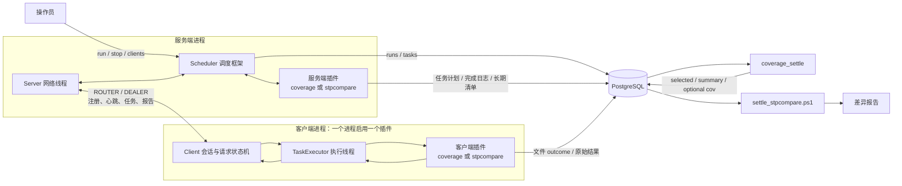
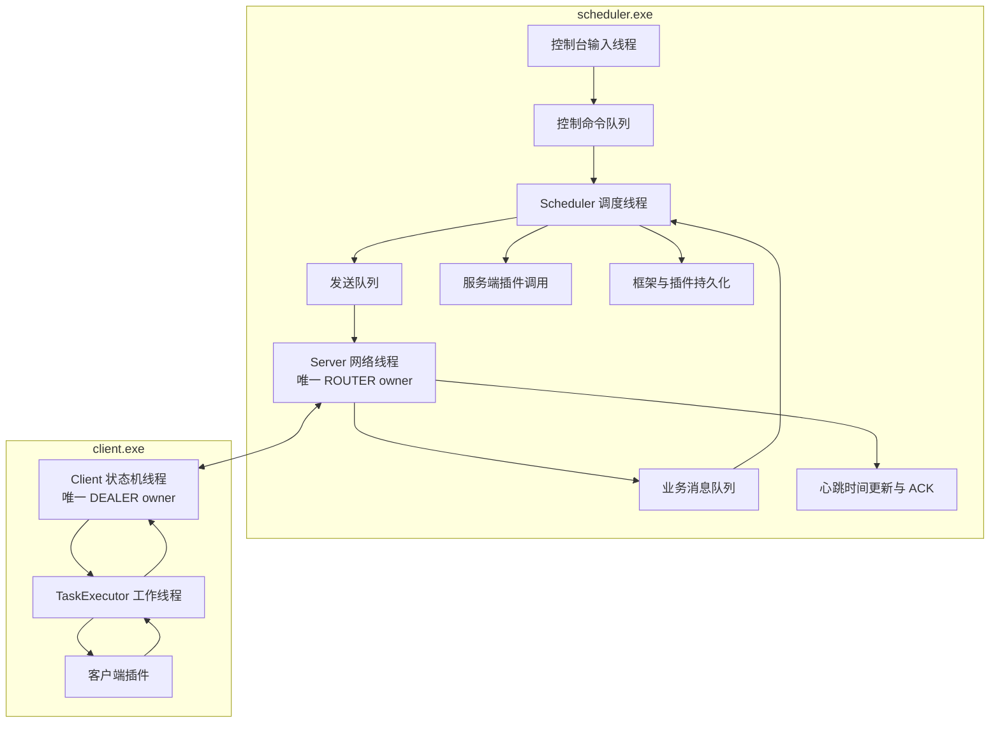
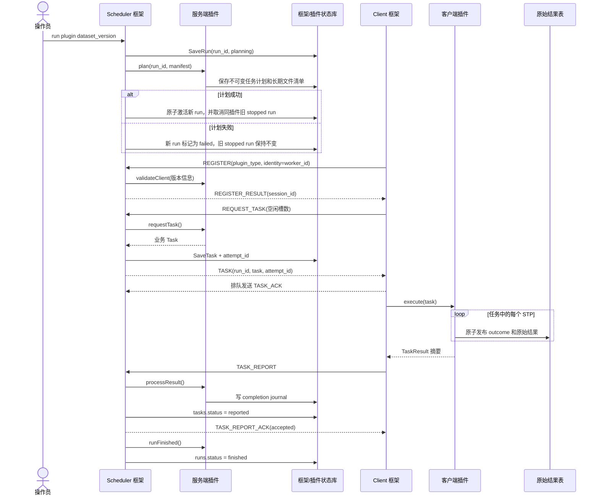
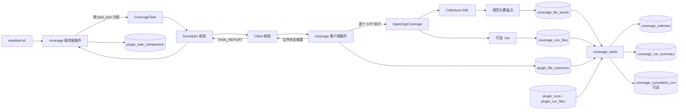
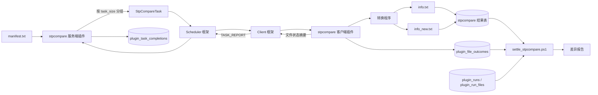
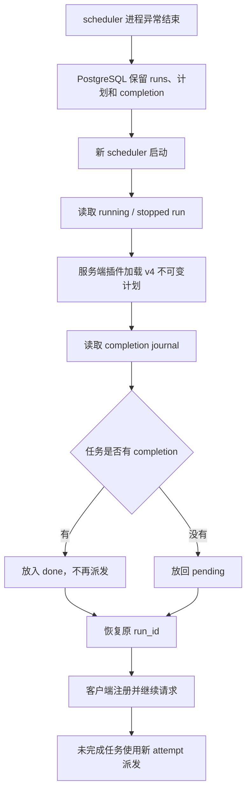
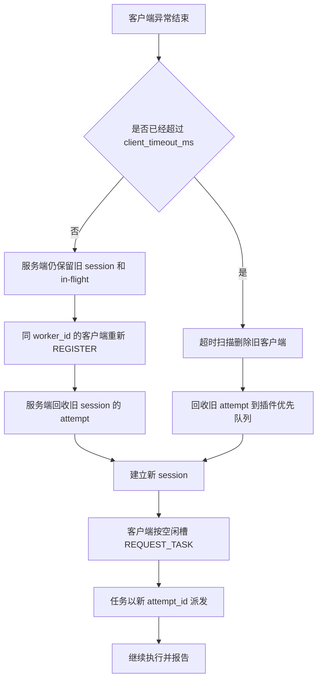
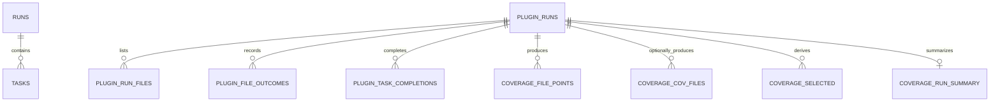

# TestTracking 设计说明

## 1. 设计概览

系统由调度框架、业务插件、客户端框架、PostgreSQL 和独立后处理工具组成。框架处理通用任务生命周期，插件处理与具体测试程序有关的逻辑。

图中的 PostgreSQL 是当前生产恢复路径。插件也保留文件存储实现，主要用于局部测试；它不属于当前服务端崩溃恢复承诺。

## 2. 模块职责

| 模块 | 主要职责 | 不处理的内容 |
| --- | --- | --- |
| `scheduler::Server` | 独占 ROUTER socket，收发消息，快速处理心跳 | 不调用插件，不访问业务数据库 |
| `scheduler::Scheduler` | 会话、run、attempt、派发、回收和命令顺序 | 不解释业务任务 payload |
| `scheduler::Storage` | 保存 `runs` 和 `tasks` | 不保存覆盖点或比较文本 |
| `common::TaskLedger` | 保存插件任务计划和完成日志，重建待处理任务 | 不执行外部程序 |
| 服务端插件 | 校验客户端、生成任务、校验任务摘要 | 不执行 STP，不生成最终分析结果 |
| `client::Client` | 注册、心跳、请求、ACK、报告重试 | 不解释业务任务 payload |
| `client::TaskExecutor` | 管理本地并发槽和取消令牌 | 不访问 scheduler 状态 |
| 客户端插件 | 执行具体程序，发布逐文件原始结果 | 不决定全局任务调度 |
| 后处理工具 | 校验完整性并生成派生结果 | 不参与在线派发 |

## 3. 线程与 Socket

ROUTER 和 DEALER 都只有一个拥有者。服务端网络线程收到合法心跳后直接更新时间并返回 ACK，其他消息排入调度线程。插件和数据库操作不会占用 ROUTER 线程，因此当前没有单独增加心跳 PUB/SUB socket。

## 4. 通用任务流

有三处顺序用于恢复：

1. 新 run 先保存为 `planning`；计划成功后，激活新 run 和取消旧 `stopped` run 在同一事务中完成。
2. scheduler 在发送 TASK 前先保存派发记录。
3. 服务端插件先保存 completion，再由 scheduler 保存框架任务报告状态。

第一步保证计划失败不会取消旧 run 的可恢复进度。第三步中途崩溃时，`tasks` 行可能仍显示旧状态。插件恢复会以 completion 为准，不会重复已经提交的业务任务；scheduler 随后根据同一 completion journal 把对应框架任务补记为 `reported`，再恢复 run。

## 5. 任务在 coverage 插件中的流动

`coverage_settle` 在 run 完成后手动运行。它先核对长期清单、outcome 和原始点集，再执行贪心筛选。任一文件缺失或失败时，不发布部分集合。

## 6. 任务在 stpcompare 插件中的流动

比较脚本比较同一次执行产生的两份文本，不负责重新执行转换程序。

## 7. 服务端异常退出恢复

恢复粒度是任务。客户端外部程序的进程内状态不会恢复；未提交 completion 的任务会从头执行。逐文件原始结果按 `(run_id, file)` 幂等保存；coverage 客户端可以跳过已经完整发布的文件。

任务 completion 对账、run 状态恢复以及不可恢复记录的关闭都属于启动条件。任一必要写入失败时 scheduler 终止启动，保留原 run 供数据库恢复后的下一次启动继续处理，避免数据库存在未完成 run 而内存把插件视为空闲。

## 8. 客户端异常退出恢复

超时前恢复依赖重启后的 `worker_id` 与原客户端相同。多台同时运行的客户端需要使用不同 `worker_id`，否则 ROUTER 会把相同 identity 当作连接接管。

## 9. 持久化数据

框架表用于在线状态和恢复，插件长期表用于结果完整性和后处理。后处理不依赖可能被清理的 `tasks` 表判断文件是否齐全。

## 10. 当前取舍

- 一个客户端进程只启用一个业务插件，使配置和执行器归属保持明确。
- 一个服务端进程可以加载多个服务端插件，并按 `plugin_type` 路由。
- `task_size` 用于在消息数量和回收粒度之间调整，不改变框架协议。
- 默认关闭任务执行租约，避免大 STP 的长任务被按固定时长误回收。
- 心跳沿用现有 ROUTER/DEALER 连接，减少额外连接和状态同步。
- 原始结果和派生结果分开保存，后处理可以在修复数据后重跑。

未纳入当前保证的组合故障见 [已知限制](已知限制.md)。
