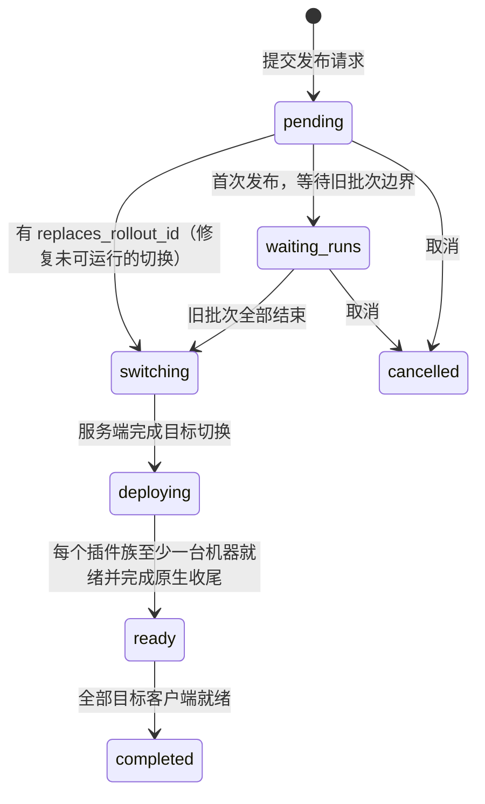

# 部署方案与资源管理

面向部署运维人员：如何用不可变制品 + 可复用方案把插件、程序和数据交付到客户端，以及滚动发布、保留旧批次、切换与回滚的完整流程。

- 前提：**Windows x64**；操作入口是结果服务网页（`http://<服务器IP>:56330/`），也可以直接调用下述 JSON API。
- 相关文档：[基础客户端与批量部署](基础客户端与批量部署.md)（Agent 与更新代理行为）、[部署与运行](部署与运行.md)（离线服务器与数据库）。

## 1. 四个核心概念


| 概念 | 含义 | 关键约束 |
| --- | --- | --- |
| **artifact** | 不可变制品，按 SHA-256 内容寻址，种类为 `plugin` / `program` / `dataset` | 同 kind+name+version 不同字节 → 409；相同内容重复上传幂等 |
| **profile** | 可复用方案：插件范围、资源角色、执行模式、并发与时间窗 | 有 `revision`，保存时校验修订号，冲突返回 409 |
| **target** | 按插件族的部署目标（目标 ID + 底层配置 + 关联方案/发布号） | 同插件族只能有一个目标；高级操作不能覆盖被统一部署管理的插件资源 |
| **rollout** | 一次滚动发布请求的状态机，按客户端推进并汇总 | 非终态时阻塞该插件的新任务提交 |

## 2. 制品管理（artifact）

### 2.1 上传

```powershell
# 上传二进制（kind/name/version 必填，filename 建议给出）
$bytes = [IO.File]::ReadAllBytes('D:\release\coverage-1.2.0.zip')
Invoke-RestMethod -Uri 'http://127.0.0.1:56330/api/artifacts/upload?kind=plugin&name=coverage&version=1.2.0&filename=coverage-1.2.0.zip' `
    -Method Post -ContentType 'application/octet-stream' -Body $bytes

# 从服务器本地路径登记（仅允许 artifact_import_roots 下的路径）
$body = @{ source_path = 'D:\staging\dataset-d2.zip'; kind = 'dataset'; name = 'stp-dataset'; version = 'd2' } | ConvertTo-Json
Invoke-RestMethod -Uri 'http://127.0.0.1:56330/api/artifacts/register' -Method Post -ContentType 'application/json' -Body $body
```

### 2.2 查询

```powershell
Invoke-RestMethod 'http://127.0.0.1:56330/api/artifacts?kind=plugin'
Invoke-RestMethod 'http://127.0.0.1:56330/api/artifacts?kind=program&name=coverage-program&version=1.2.0'
```

- `GET /api/artifacts/<artifact_id>` 返回单个制品的元数据记录。
- `GET /api/artifacts/<artifact_id>/resources` 返回该制品的内容清单：`files`、`directories`、`executables`、`dlls` 与 `dataset_roots`。部署表单里的包内执行入口、采集模块（`engine_dlls`）和数据集根目录都从这份清单里选。
- `GET /api/artifacts/objects/<sha256>` 是客户端下载入口，内容不可变。
- 服务端包的制品库位于 `data/artifacts`（`catalog.json` + `objects/<前两位>/<sha256>`）；源配置由 `artifact_store_dir` 指定。
- 制品库**不写结果数据库**。

### 2.3 三类制品各自要求

| 种类 | 角色 | 要求 |
| --- | --- | --- |
| `plugin` | 客户端插件包（ZIP） | 含插件 DLL；服务端用其中的 DLL 列表做 `engine_dlls` 校验 |
| `program` | 业务程序包（ZIP） | 需指定包内相对入口；coverage 的程序包同时提供 `dlls` 供采集模块选择；stpcompare 需要两个程序包（baseline/candidate） |
| `dataset` | 数据集包（ZIP） | 提供包内根目录；数据集版本与 manifest 仍需单独配置（上传数据集不会自动更新调度器 manifest） |

## 3. 方案管理（profile）

### 3.1 结构

```json
{
  "name": "coverage 1.2.0 / d2",
  "description": "上线覆盖率采集 1.2.0，数据集 d2",
  "plugins": {
    "coverage": {
      "dry_run": false,
      "store_cov": true,
      "engine_dlls": ["TKernel.dll", "TKBRep.dll"],
      "resources": {
        "plugin":   { "artifact_id": "..." },
        "program":  { "artifact_id": "...", "entry": "bin/StepTest.exe" },
        "collector":{ "artifact_id": "...", "entry": "OpenCppCoverage.exe" },
        "dataset":  { "artifact_id": "...", "root": "" }
      }
    }
  },
  "schedule": {
    "task_threads": 2,
    "execution_windows": [],
    "update_windows": []
  }
}
```

规则（`result_service/app/deployment_profiles.py`）：

- 插件范围只允许 `coverage` 与 `stpcompare`；
- **资源角色必须齐全**：coverage 为 `plugin`/`program`/`collector`/`dataset`，stpcompare 为 `plugin`/`baseline`/`candidate`/`dataset`；
- `dry_run` 必须显式给出布尔值，不接受缺省；
- coverage 的 `engine_dlls` 必须存在于程序包的 DLL 列表中，否则 422 拒绝；
- stpcompare 的两个角色参数模板默认 `["--input","{stp}","--output-dir","{outdir}"]`；
- `schedule` 只允许 `task_threads`、`execution_windows`、`update_windows`。

### 3.2 保存与预览

```powershell
# 新建（POST 到集合）
$body = Get-Content .\profile.json -Raw
Invoke-RestMethod -Uri 'http://127.0.0.1:56330/api/deployment-profiles' -Method Post -ContentType 'application/json' -Body $body

# 修改（PUT 到单个方案，必须带 revision）
Invoke-RestMethod -Uri 'http://127.0.0.1:56330/api/deployment-profiles/<profile_id>' -Method Put -ContentType 'application/json' -Body $body

# 预览（不发布）
$body = @{ revision = '<profile revision>'; client_ids = @('worker-01'); mode = 'assign' } | ConvertTo-Json -Depth 6
Invoke-RestMethod -Uri 'http://127.0.0.1:56330/api/deployment-profiles/<profile_id>/preview' -Method Post -ContentType 'application/json' -Body $body
```

预览返回规范化后的 patch、`program_bindings`、建议的 `scheduler_plugins`、`scheduler_revision` 与警告。

### 3.3 程序身份

制品支撑的 coverage/stpcompare 程序版本由 `result_service/app/program_bindings.py` 派生：程序包 SHA-256 + 包内相对入口 + 执行设置（coverage 含 `program_dir`、`opencppcoverage`、`engine_dlls`、`store_cov`、`dry_run`；stpcompare 含两个角色的参数与 `dry_run`），依赖程序包的内容哈希与相对路径也计入。写入 `coverage.program_version` 或 `stpcompare.programs.<role>.version`，形如 `sha256:...`。人工版本标签与本地下载缓存位置不参与身份。

**推荐做法**：预览后使用"保存服务端匹配配置"把 expected 字段写进 `runtime/scheduler.json`，然后重启调度器。该操作要求相关插件没有未完成 run，无法核实时会阻止保存。

## 4. 发布（rollout）

### 4.1 阶段状态机



- **waiting_runs**：发布请求先固定"旧批次边界"——正在排队与在途的旧 run 继续用旧版本跑完，期间该插件不接受新任务提交（提交会返回"该插件正在更新"）。
- **switching → deploying**：服务端把新目标写入调度器（`apply_plugin_deployment`），随后按客户端推进各自期望代。
- **ready / completed**：`ready` 表示每个变更插件至少有一台在线机器已就绪并且原生侧已收尾；`completed` 表示所有目标客户端就绪。

### 4.2 提交发布

```powershell
$body = @{
    request_id       = '<唯一请求 ID>'
    revision         = '<profile revision>'
    mode             = 'assign'                 # 或 update
    client_ids       = @('worker-01','worker-02')
    plan_fingerprint = '<预览返回的指纹>'
    operator_id      = 'ops-1'
    reason           = '上线 coverage 1.2.0'
} | ConvertTo-Json -Depth 6
Invoke-RestMethod -Uri 'http://127.0.0.1:56330/api/deployment-profiles/<profile_id>/publish' `
    -Method Post -ContentType 'application/json' -Body $body
```

- `request_id` 唯一标识一次发布；重复提交同一 `request_id` + 相同内容返回既有请求，内容不同则拒绝。
- `plan_fingerprint` 必须与预览一致；方案、模板、目标机器或配置任一处变化都会要求重新预览。
- 同一插件族已有未完成请求时，新的发布被拒绝（先完成或取消）。

### 4.3 查询与操作

```powershell
# 列表与详情
Invoke-RestMethod 'http://127.0.0.1:56330/api/deployment-rollouts'
Invoke-RestMethod 'http://127.0.0.1:56330/api/deployment-rollouts/<rollout_id>'

# 取消（仅 pending / waiting_runs 阶段）
$body = @{ revision = '<请求 revision>'; action = 'cancel' } | ConvertTo-Json
Invoke-RestMethod -Uri 'http://127.0.0.1:56330/api/deployment-rollouts/<rollout_id>/cancel' -Method Post -ContentType 'application/json' -Body $body

# 重试失败机器
$body = @{ revision = '<请求 revision>'; action = 'retry'; client_ids = @('worker-02') } | ConvertTo-Json
Invoke-RestMethod -Uri 'http://127.0.0.1:56330/api/deployment-rollouts/<rollout_id>/retry' -Method Post -ContentType 'application/json' -Body $body

# 处理已停止的旧批次（waiting_runs 阶段）
$body = @{ revision = '<请求 revision>'; action = 'resume'; plugin_type = 'coverage'; run_id = '<run_id>' } | ConvertTo-Json
Invoke-RestMethod -Uri 'http://127.0.0.1:56330/api/deployment-rollouts/<rollout_id>/resume' -Method Post -ContentType 'application/json' -Body $body

# 放弃旧批次（必须填写原因）
$body = @{ revision = '<请求 revision>'; action = 'abandon'; plugin_type = 'coverage'; run_id = '<run_id>'; reason = '旧批次作废' } | ConvertTo-Json
Invoke-RestMethod -Uri 'http://127.0.0.1:56330/api/deployment-rollouts/<rollout_id>/abandon' -Method Post -ContentType 'application/json' -Body $body
```

- 所有操作都必须带列表/详情读到的 `revision`；过期 revision 返回 409 并给出当前值。
- `cancel` 只在尚未进入切换时可用；已经切换的发布不能取消。
- `retry` 只对有失败机器的请求有效；可只重试指定客户端。
- `resume`/`abandon` 只对当前边界内处于 `stopped` 的旧批次有效；`abandon` 需要原因。

### 4.4 接管与替换

- 若一次发布处于 `switching`/`deploying` 但机器始终无法就绪，可以提交一个 `replaces_rollout_id` 指向它的新请求（相同插件范围、相同 `replaces_revision`），新请求会直接进入 `switching` 并接管；旧请求被标记为 `superseded`。
- 单机级修复走机器页的重新分配/回滚入口；统一部署管理中的插件资源不能被高级操作覆盖，只能通过方案或机器入口调整（并发与时间窗可以单独调整）。

## 5. 保留、切换与回滚

- **保留旧批次**：发布进入 `waiting_runs` 时固定边界，边界内的排队与在途 run 继续执行；边界未清空不会切换。这正是"当前整批及已排队批次使用旧版完成后自动切换"的实现方式。
- **离线机器**：离线的目标机器上线后按最新目标补齐；旧请求的快照不会被复活（新目标会取代旧的追赶请求）。
- **回滚**：对单客户端重新发布历史代即可。`PUT /api/deployments/<client>/desired` 支持：

```powershell
$body = @{ revision = '<当前 desired revision>'; action = 'rollback'; target_revision = '<历史 revision>'; reason = '回滚' } | ConvertTo-Json
Invoke-RestMethod -Uri 'http://127.0.0.1:56330/api/deployments/worker-01/desired' -Method Put -ContentType 'application/json' -Body $body
```

回滚会把历史代的组件与配置补丁作为**新的期望代**重新发布（不能同时覆盖组件或配置）。

- **再次前进**：从方案再次发布即形成新代。注意"切走再切回同一组组件"也会生成新代，这样旧回执不会被误认为当前安装。

## 6. 期望态与回执（单客户端视角）

```powershell
Invoke-RestMethod 'http://127.0.0.1:56330/api/deployments'
Invoke-RestMethod 'http://127.0.0.1:56330/api/deployments/worker-01'
```

- `GET /api/deployments/<client>` 返回协调状态、`desired`、`reported` 与历史（最多 10 代）。
- `PUT /api/deployments/<client>/desired` 接收 `revision`（首次为 `null`）、`components`、`config_patch`、可选 `operator_id`/`reason`；写入过期 revision 返回 409。
- `POST /api/deployments/preview` 校验方案但不发布，返回规范化 patch、`program_bindings`、建议的服务端字段与警告。
- `PUT /api/deployments/<client>/reported` 由客户端更新代理调用，见 [基础客户端与批量部署](基础客户端与批量部署.md) 第 6 节。
- 配置补丁支持 `{artifact:slot}` 与 `{artifact:slot}/相对路径` 引用；引用必须占满整个字符串值、必须指向同一次期望计划中的槽位，且不能越出制品目录。`client.worker_id` 与 `client.deployment_endpoint` 不能被补丁修改。

## 7. 与调度器的一致性

| 关注点 | 机制 |
| --- | --- |
| 程序版本一致性 | 预览时给出建议 expected 字段；"保存服务端匹配配置"在确认没有未完成 run 后写入，并在保存后要求重启调度器 |
| 新任务准入 | 插件族处于非终态发布期间，该插件的新任务提交被拒绝（409，提示等待新版可运行） |
| 机器预留 | 服务端按物理机申请预留（reservation），避免同一台机器被并发更新；预留带提交与过期语义 |
| 高级操作保护 | 被统一目标管理的插件资源不能被插件/配置类高级操作改写；相关配置保存会被拒绝 |

## 8. 失败处理

| 现象 | 原因 | 处理 |
| --- | --- | --- |
| 发布一直停在 `waiting_runs` | 边界内旧批次未结束 | 查看阻塞 run；等待完成，或对 `stopped` 批次 `resume`/`abandon` |
| 某客户端长期 `failed` | 该代在该机器上被锁存 | 修复原因并发布新修订；必要时清理该机 `deployments\objects` 下对应哈希目录 |
| 预览/发布返回 409（plan fingerprint） | 方案、模板或目标机器已变化 | 重新预览并重新提交，不要复用旧指纹 |
| 保存服务端匹配配置被拒 | 相关插件有活动/排队/可恢复 run | 等 run 结束或先停止该 run，再保存并重启调度器 |
| 调度器离线 | 管理通道不可达 | 部署类操作返回明确错误；恢复调度器后重试，注意 revision 可能已变 |
| 修改被"高级操作"拒绝 | 该插件资源由统一目标管理 | 走方案/发布入口，或只调整并发与时间窗 |

## 9. 交叉引用

- [基础客户端与批量部署](基础客户端与批量部署.md)
- [部署与运行](部署与运行.md)
- [设计说明](设计说明.md)
- [已知限制](已知限制.md)
