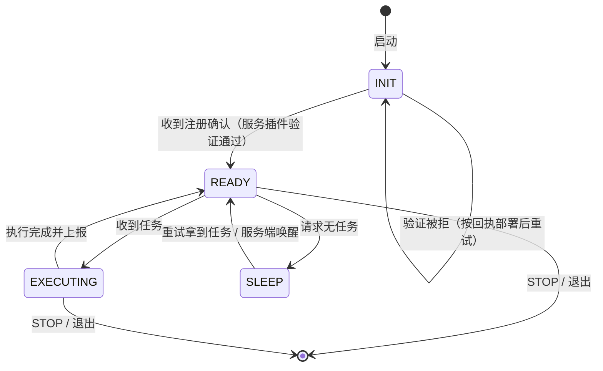

# stp-test-tracking 需求说明文档

| 项目名称 | stp-test-tracking 通用测试执行调度系统 |
| --- | --- |
| 文档版本 | v0.6（框架设计讨论稿） |
| 状态 | 讨论稿 |
| 日期 | 2026-08-15 |
| 上一版本 | v0.5（2026-08-12），本文重写框架与执行流部分 |

## 1. 系统定位与设计原则

本系统是一套**通用的分布式测试执行框架**，由调度中心与客户机组成，框架本身不绑定任何具体测试程序；业务通过可插拔插件接入（首个适配对象为覆盖率服务 StepTest）。

**核心原则：框架与业务严格分离——框架不能做业务的事情，业务不能做框架的事情。**

- 框架职责：通信与路由、客户端注册表、单任务派发、in-flight 租约超时、心跳存活判定、客户端状态机、线程与模块生命周期、进度持久化。
- 业务（插件）职责：客户端资格验证（程序/数据版本与部署状态）、任务规划、任务内容定义与解析、结果解释与存储、程序与数据的部署拷贝。
- 边界规则：
  1. 框架只解析信封头（消息类型、task_type、request_id、路由身份）；业务 payload 一律**不拆解、不解释**，原样透传。
  2. 插件不接触 socket、不管理线程、不参与消息路由；并发与生命周期由框架负责。
  3. 客户端是否满足处理任务的条件，由**服务端插件**判断，框架不做业务判断。

## 2. 总体架构与模块划分

### 2.1 服务框架（调度中心）

| 模块 | 职责 |
| --- | --- |
| 通信模块（服务端） | ROUTER 收发、消息编解码、发送队列与背压、在线状态刷新 |
| 调度模块 | 客户端注册表（task_type → 版本/数据版本/客户端列表）、任务路由与单任务派发、in-flight 租约超时、离线检测与任务回收、运行生命周期、启动规划与进度恢复 |
| 服务端插件模块 | 加载/管理插件 DLL、按 task_type 注册插件、把 REGISTER 验证消息、REQUEST_TASK、结果报告透传给插件、把插件的业务回执透传回客户端 |

### 2.2 客户端框架

| 模块 | 职责 |
| --- | --- |
| 插件管理模块 | 加载插件 DLL、init、收集注册信息、按 task_type 找到执行插件 |
| 状态机模块 | INIT / READY / EXECUTING / SLEEP 状态迁移与事件驱动 |
| 通信模块（客户端） | DEALER 收发、消息编解码、心跳定时、发送队列 |
| 任务请求/退避模块 | 发起 REQUEST_TASK、无任务退避、唤醒处理 |
| 执行模块 | 接任务、交给对应客户端插件、等待完成、组装任务执行报告 |

### 2.3 common

配置、日志、ZMQ 封装、阻塞队列、事件池、协议消息。

## 3. 客户端状态机与执行流



| 状态 | 行为 | 迁移 |
| --- | --- | --- |
| INIT | 加载插件 → 收集注册信息 → 发送 REGISTER → 等待验证 | 验证通过 → READY；被拒 → 按回执处理（如部署）后重试，超限退出 |
| READY | 发送心跳 + 发送 REQUEST_TASK | 收到任务 → EXECUTING；无任务 → SLEEP |
| EXECUTING | 任务交给对应客户端插件，等待完成 | 上报完成 → READY |
| SLEEP | 按退避间隔重试 REQUEST_TASK | 拿到任务 → READY；服务端唤醒 → READY |

要点：

- 客户端**初始化阶段（INIT）不启动任何线程**；验证通过后才启动运行时线程（通信/心跳/执行）。
- 同一客户端同时只执行 1 个任务（串行），执行完成后立即请求下一个任务。

## 4. 注册验证流程（初始化）

以覆盖率插件为例：

1. 客户端启动 → 加载客户端插件 → 插件检查本地部署（StepTest 程序、编译数据、版本）→ 插件生成业务验证消息（本地程序版本、数据版本、路径状态等，格式业务自定）→ 客户端框架发送 REGISTER（信封头 + 不透明业务 payload）。
2. 服务端通信模块收到 REGISTER → 调度模块按 task_type 找到服务端插件 → 把客户端信息与业务 payload **原样**交给插件。
3. 服务端插件判断该客户端是否满足处理任务的条件（程序版本匹配、数据版本与就绪状态、部署完整等）：
   - 满足 → 返回"通过"（可附业务回执）→ 框架回 REGISTER_ACK → 客户端进入 READY。
   - 不满足（如未部署 / 版本不符）→ 返回"拒绝" + 业务回执（含目标版本、共享目录位置等）→ 框架原样透传回执 → 客户端把回执交给客户端插件。
4. 客户端插件解析回执；若需要部署：从共享目录把程序/数据拷贝到本地 → 更新本地版本 → 客户端重新发送 REGISTER，直至通过或重试超限。
5. 验证通过后，客户端才启动运行时线程，进入就绪态。

约定：REGISTER 的 payload 与回执 payload 均为**业务不透明消息**，框架不拆解、不解释；部署判断与拷贝逻辑完全属于插件。

共享目录：**可以且推荐使用共享目录**（网络共享 / 共享存储）作为程序与数据的唯一权威来源；客户端本地是镜像副本，执行时只读本地。框架不关心共享目录的具体形态，由插件配置与实现负责。

## 5. 插件接口定义

### 5.1 服务端插件基类（common::TaskPlugin）

```cpp
struct ValidationResult {
    bool accepted = false;       // 是否满足处理任务条件
    std::string reply_payload;   // 业务回执（不透明，如部署指示）
    std::string reason;          // 供框架日志使用，不承载业务语义
};

class TaskPlugin {
public:
    virtual ~Plugin() = default;

    virtual std::string taskType() const = 0;

    // 加载配置、检查业务前提（程序/数据/manifest/共享目录等）。
    virtual bool init(const std::string& config) = 0;

    // 初始化阶段验证：REGISTER 到达时调用；
    // client_message 为业务不透明消息，框架不解析。
    virtual bool validateClient(const ClientInfo& client,
                                const std::string& client_message,
                                ValidationResult& result) = 0;

    // Run 规划（可自由分波次），任务池由插件内部维护。
    virtual bool plan(const RunRequest& request,
                      const std::vector<ClientInfo>& clients) = 0;

    // 客户端 REQUEST_TASK 时调用：插件给出 1 个任务或空（无任务）。
    virtual bool requestTask(const ClientInfo& client,
                             TaskSpec* task) = 0;

    // 结果处理（任务执行报告）。
    virtual void processResult(const TaskResult& result) = 0;

    // 掉线客户端的在飞任务归还。
    virtual void requeue(const std::vector<std::string>& task_ids) = 0;
};
```

### 5.2 客户端插件基类（common::WorkerPlugin）

```cpp
class WorkerPlugin {
public:
    virtual ~ClientPlugin() = default;

    virtual std::string taskType() const = 0;

    // 加载配置、检查本地部署。
    virtual bool init(const std::string& config) = 0;

    // 初始化阶段：检查本地部署并产出注册业务消息（不透明）。
    virtual bool collectRegistrationInfo(std::string* payload) = 0;

    // 处理服务插件回执（如部署/更新本地副本）；
    // 返回是否已就绪、可重新注册。
    virtual bool handleValidationReply(const std::string& reply_payload) = 0;

    // 执行一个任务，填写执行报告。
    virtual bool execute(const TaskSpec& task, TaskResult& result) = 0;
};
```

## 6. 消息协议清单

| 消息 | 方向 | 框架字段 | 业务字段 |
| --- | --- | --- | --- |
| REGISTER | 客户端 → 服务端 | task_type、identity、ip/port（可选） | 业务验证消息（bytes，不透明） |
| REGISTER_ACK / REGISTER_REJECT | 服务端 → 客户端 | 结果标记 | 业务回执（bytes，不透明） |
| HEARTBEAT | 客户端 → 服务端 | worker_id、状态、数据集就绪、资源占用 | — |
| REQUEST_TASK | 客户端 → 服务端 | task_type | —（可选附加状态） |
| TASK（单任务） | 服务端 → 客户端 | run_id、task_id、task_type | 任务 payload（bytes，不透明） |
| NO_TASK | 服务端 → 客户端 | — | — |
| TASK_REPORT | 客户端 → 服务端 | task_id、exit_code、耗时、产物路径 | 结果 payload（bytes，不透明） |
| WAKE（可选） | 服务端 → 客户端 | — | — |

## 7. 调度端启动与运行职责

启动序列：

1. 加载配置的插件；检查每个插件声明的业务前提（程序/数据/manifest 等），不满足则启动失败并明确报错。
2. 恢复上一次的任务分配进度（持久化介质当前为本地文件，预留 DB 接口）。
3. 调插件 plan，生成任务池/波次。
4. 启动通信模块，开始监听。

运行期：

- 客户端注册表：`map<task_type, {程序版本, 数据集版本, 客户端列表(identity, ip, port, 状态, 健康, last_seen)}>`，由 REGISTER / HEARTBEAT / REQUEST_TASK / TASK_REPORT 更新。
- 派发规则：**谁请求给谁**，每次 1 个任务；请求到达时由对应插件决定给不给、给哪个任务。
- in-flight 租约：任务发出后计时，超时未回报 → 重派（按 task_id 幂等去重）。
- 离线：超过阈值未收到任何消息的客户端移除，其 in-flight 任务 requeue 给插件。

## 8. 任务规划与执行

- 规划完全由插件负责（覆盖率插件示例：把总任务按 batch 分波次，波次内再分任务）。
- 调度模块不关心规划内容，只负责把插件给出的任务单发到请求它的客户端。
- 客户端执行完成后上报 TASK_REPORT（任务执行报告），框架转给插件 processResult。

## 9. 结果上报与存储

- 客户端以 TASK_REPORT 上报执行结果；框架只透传。
- 单次任务结果很大时（覆盖率插件），客户端先把大结果落库；**数据库未部署前用本地文件替换**（CoverageStore 文件实现，接口预留 DB 实现）。
- 数据库部署后，数据库是进度与结果的唯一事实来源。

## 10. 程序与数据集部署

- 共享目录为程序与数据的唯一权威来源（规模假设：stp 首例约 4 万个文件、单文件 0.2~10 MB、总量 100GB+）。
- 客户端本地为镜像副本；执行只读本地。
- 版本校验与部署拷贝由插件负责（服务端插件判断、客户端插件执行）。
- 数据未就绪 / 版本不符的客户端不参与派发。

## 11. 异常与恢复

| 场景 | 处理 |
| --- | --- |
| 初始化验证被拒 | 客户端按回执部署后重试，超限退出 |
| 执行中客户端死亡 | in-flight 租约超时 → 重派（幂等） |
| 客户端掉线 | 移除注册表项，任务 requeue |
| 重复上报 | 按 task_id 幂等去重 |
| 调度端重启 | 恢复持久化进度后重新规划剩余任务 |

## 12. 一期范围与延后内容

延后：STOP、SYNC_DATASET、VERIFY_DATASET、QUERY_STATUS、UPDATE_PROGRAM、数据展示模块、规则引擎、bug 生命周期、客户端结果缓存。协议字段可预留，本期不实现。

## 13. 待确认清单

1. 注册确认语义：推荐"验证通过即 ACK，任务走 REQUEST_TASK"（不把注册与派发耦合）。
2. 休眠唤醒：推荐先做纯退避（如 1s/2s/4s…封顶 30s），WAKE 消息预留。
3. 客户端并发：一期固定每客户端 1 个并发任务。
4. in-flight 租约默认时长（推荐 30 分钟，可配置）。
5. 同一 task_type 多 Run：一期限制同时 1 个活跃 Run。
6. 进度持久化介质：先本地文件，预留 DB。
7. 共享目录配置：两侧插件配置共享目录路径（或由回执携带），待定。
