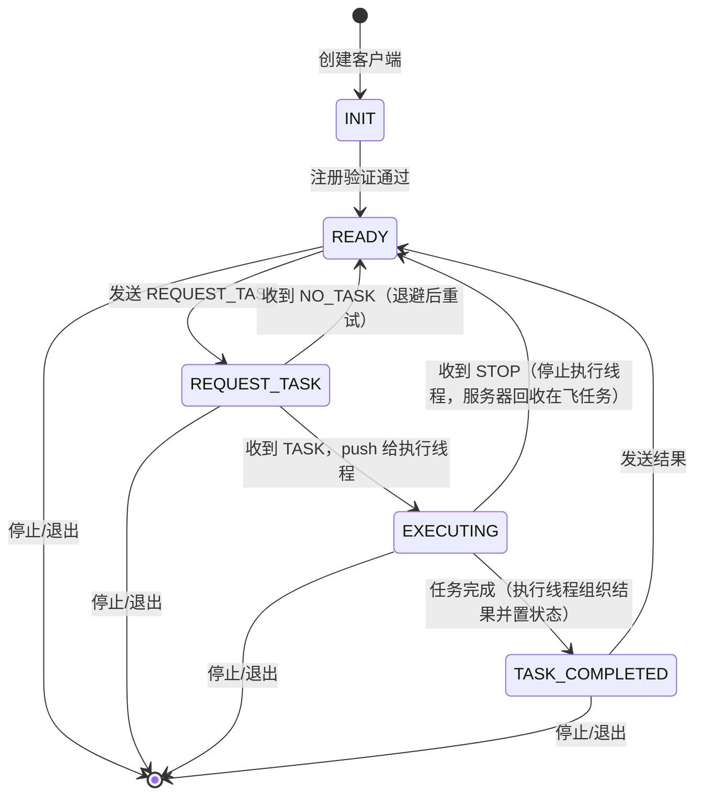

# stp-test-tracking 需求说明文档

| 项目名称 | stp-test-tracking 通用测试执行调度系统 |
| --- | --- |
| 文档版本 | v0.7（本轮重构计划） |
| 状态 | 计划中 |
| 日期 | 2026-08-17 |
| 上一版本 | v0.6（2026-08-15），本文在其基础上新增本轮重构计划 |

## 1. 系统定位与设计原则

本系统是一套**通用的分布式测试执行框架**，由调度中心与客户机组成，框架本身不绑定任何具体测试程序；业务通过可插拔插件接入（首个适配对象为覆盖率服务 StepTest）。

**核心原则：框架与业务严格分离——框架不能做业务的事情，业务不能做框架的事情。**

- 框架职责：通信与路由、客户端注册表、单任务派发、in-flight 租约超时、心跳存活判定、客户端状态机、线程与模块生命周期、进度持久化。
- 业务（插件）职责：客户端资格验证（程序/数据版本与部署状态）、任务规划、任务内容定义与解析、结果解释与存储、程序与数据的部署拷贝。
- 边界规则：
  1. 框架只解析信封头（消息类型、plugin_type、路由身份）；业务 payload 一律**不拆解、不解释**，原样透传。
  2. 插件不接触 socket、不管理线程、不参与消息路由；并发与生命周期由框架负责。
  3. 客户端是否满足处理任务的条件，由**服务端插件**判断，框架不做业务判断。

## 2. 总体架构与模块划分

### 2.1 服务框架（调度中心）

| 模块 | 职责 |
| --- | --- |
| 通信模块（服务端） | ROUTER 收发、消息编解码、发送队列与背压、在线状态刷新 |
| 调度模块 | 客户端注册表（plugin_type → 版本/数据版本/客户端列表）、任务路由与单任务派发、in-flight 租约超时、离线检测与任务回收、运行生命周期、启动规划与进度恢复 |
| 服务端插件模块 | 加载/管理插件 DLL、按 plugin_type 注册插件、把 REGISTER 验证消息、REQUEST_TASK、结果报告透传给插件、把插件的业务回执透传回客户端 |

### 2.2 客户端框架

| 模块 | 职责 |
| --- | --- |
| 插件管理模块 | 加载插件 DLL、init、收集注册信息、按 plugin_type 找到执行插件 |
| 状态机模块 | INIT / READY / EXECUTING / SLEEP 状态迁移与事件驱动 |
| 通信模块（客户端） | DEALER 收发、消息编解码、心跳定时、发送队列 |
| 任务请求/退避模块 | 发起 REQUEST_TASK、无任务退避、唤醒处理 |
| 执行模块 | 接任务、交给对应客户端插件、等待完成、组装任务执行报告 |

### 2.3 common

配置、日志、ZMQ 封装、阻塞队列、事件池、协议消息。

## 3. 客户端状态机与执行流



| 状态 | 行为 | 迁移 |
| --- | --- | --- |
| INIT | 加载插件 → 注册验证（不启线程） | 验证通过 → READY；被拒 → 按回执处理（如部署）后重试，超限退出 |
| READY | 心跳 + 接收消息；到期发送 REQUEST_TASK | → REQUEST_TASK |
| REQUEST_TASK | 心跳 + 接收消息 | 收到 TASK → EXECUTING；收到 NO_TASK → READY（退避后重试） |
| EXECUTING | 心跳 + 接收消息；任务在执行线程串行执行 | 任务完成 → TASK_COMPLETED；收到 STOP → 停止执行线程 → READY |
| TASK_COMPLETED | 心跳 + 发送结果 | → READY |

要点：

- 客户端**初始化阶段（INIT）不启动任何线程**；验证通过后才启动执行线程。
- **主线程即状态机**：收发消息与状态迁移都在主线程完成。
- 执行器封装为独立对象（复用 common::EventManager 单线程），对外提供 push(task) 与 stop()；stop() 清空未执行任务。
- 收到 STOP 时：执行器停止并清空任务队列，**正在执行的任务等待完成后结果丢弃**；服务器按 in_flight 表回收该客户端在飞任务并重派（at-least-once 语义，同一任务可能被执行两次）；客户端回到 READY。
- 同一客户端同时只执行 1 个任务（串行），执行完成后立即请求下一个任务。

## 4. 注册验证流程（初始化）

以覆盖率插件为例：

1. 客户端启动 → 加载客户端插件 → 插件检查本地部署（StepTest 程序、编译数据、版本）→ 插件生成业务验证消息（本地程序版本、数据版本、路径状态等，格式业务自定）→ 客户端框架发送 REGISTER（信封头 + 不透明业务 payload）。
2. 服务端通信模块收到 REGISTER → 调度模块按 plugin_type 找到服务端插件 → 把客户端信息与业务 payload **原样**交给插件。
3. 服务端插件判断该客户端是否满足处理任务的条件（程序版本匹配、数据版本与就绪状态、部署完整等）：
   - 满足 → 插件返回业务回执 → 框架以 REGISTER_RESULT 原样透传 → 客户端插件解析后进入 READY。
   - 不满足（如未部署 / 版本不符）→ 返回"拒绝" + 业务回执（含目标版本、共享目录位置等）→ 框架原样透传回执 → 客户端把回执交给客户端插件。
4. 客户端插件解析回执；若需要部署：从共享目录把程序/数据拷贝到本地 → 更新本地版本 → 客户端重新发送 REGISTER，直至通过或重试超限。
5. 验证通过后，客户端才启动运行时线程，进入就绪态。

约定：REGISTER 的 payload 与回执 payload 均为**业务不透明消息**，框架不拆解、不解释；部署判断与拷贝逻辑完全属于插件。

共享目录：**可以且推荐使用共享目录**（网络共享 / 共享存储）作为程序与数据的唯一权威来源；客户端本地是镜像副本，执行时只读本地。框架不关心共享目录的具体形态，由插件配置与实现负责。

## 5. 插件接口定义

插件 DLL 契约：插件必须链接 common（框架符号经 common.dll 导出），且与框架进程使用**同一 CRT**（MSVC `/MD` 或 `/MDd` 一致），否则跨 DLL 边界传递对象或释放内存会导致崩溃。

### 5.1 服务端插件基类（common::TaskPlugin）

```cpp
struct ValidationResult {
    bool accepted = false;       // 是否满足处理任务条件
    std::string reply_payload;   // 业务回执（不透明，如部署指示）
    std::string reason;          // 供框架日志使用，不承载业务语义
};

class TaskPlugin {
public:
    virtual ~TaskPlugin() = default;

    virtual std::string pluginType() const = 0;

    // 加载配置、检查业务前提（程序/数据/manifest/共享目录等）。
    virtual bool init(const std::string& config) = 0;

    // 初始化阶段验证：REGISTER 到达时调用；
    // client_message 为业务不透明消息，框架不解析。
    virtual bool validateClient(const ClientInfo& client,
                                const std::string& client_message,
                                ValidationResult& result) = 0;

    // Run 规划（可自由分波次），任务池由插件内部维护。
    virtual bool plan(const RunRequest& request,
                      const std::vector<ClientInfo>& clients) = 0;

    // 客户端 REQUEST_TASK 时调用：有任务则填充 task 并返回 true，
    // 无任务返回 false。request_payload 为客户端请求携带的业务数据（不透明）。
    virtual bool requestTask(const ClientInfo& client,
                             const std::string& request_payload,
                             Task& task) = 0;

    // 结果处理（任务执行报告）。
    virtual void processResult(const TaskResult& result) = 0;

    // 当前 run 是否已完全结束（无待处理任务），由插件判定。
    virtual bool runFinished() = 0;

    // 取消当前 run：插件清空自己的任务池（含未派发任务）。
    virtual void cancel() = 0;

    // 掉线客户端的在飞任务归还。
    virtual void requeue(const std::vector<std::string>& task_ids) = 0;
};
```

### 5.2 客户端插件基类（common::WorkerPlugin）

```cpp
class WorkerPlugin {
public:
    virtual ~WorkerPlugin() = default;

    virtual std::string pluginType() const = 0;

    // 加载配置、检查本地部署。
    virtual bool init(const std::string& config) = 0;

    // 初始化阶段：检查本地部署并产出注册业务消息（不透明）。
    virtual bool collectRegistrationInfo(std::string* payload) = 0;

    // 处理服务插件回执（不透明业务消息）：返回 kReady（就绪进入 READY）、
    // kRetry（已处理如部署，重新注册）或 kFailed（无法满足，放弃）。
    virtual RegisterOutcome handleValidationReply(const std::string& reply_payload) = 0;

    // 执行一个任务，填写执行报告。
    virtual bool execute(const Task& task, TaskResult& result) = 0;
};
```

## 6. 消息协议清单

| 消息 | 方向 | 框架字段 | 业务字段 |
| --- | --- | --- | --- |
| REGISTER | 客户端 → 服务端 | plugin_type（信封）、identity（ZMQ 帧） | 业务验证消息（bytes，不透明） |
| REGISTER_RESULT | 服务端 → 客户端 | plugin_type（信封） | 业务回执（bytes，不透明，插件定义） |
| HEARTBEAT | 客户端 → 服务端 | plugin_type（信封）、IP、状态、资源占用 | — |
| REQUEST_TASK | 客户端 → 服务端 | plugin_type（信封） | —（可选附加状态） |
| TASK（单任务） | 服务端 → 客户端 | plugin_type（信封）、run_id、task_id | 任务 payload（bytes，不透明） |
| TASK_ACK | 客户端 → 服务端 | plugin_type（信封）、task_id | — |
| NO_TASK | 服务端 → 客户端 | — | — |
| TASK_REPORT | 客户端 → 服务端 | task_id、exit_code、耗时、产物路径 | 结果 payload（bytes，不透明） |
| WAKE（可选） | 服务端 → 客户端 | — | — |
| STOP | 服务端 → 客户端 | plugin_type（信封）、run_id、reason | — |

## 7. 调度端启动与运行职责

启动序列：

1. 加载配置的插件；检查每个插件声明的业务前提（程序/数据/manifest 等），不满足则启动失败并明确报错。
2. 恢复上一次的任务分配进度（持久化介质当前为本地文件，预留 DB 接口）。
3. 调插件 plan，生成任务池/波次。
4. 启动通信模块，开始监听。

运行期：

- 客户端注册表：`map<plugin_type, {程序版本, 数据集版本, 客户端列表(identity, ip, port, 状态, 健康, last_seen)}>`，由 REGISTER / HEARTBEAT / REQUEST_TASK / TASK_REPORT 更新。
- 派发规则：**谁请求给谁**，每次 1 个任务；框架保证同一客户端同时最多 1 个在飞任务；请求到达时由对应插件决定给不给、给哪个任务。
- 派发门槛：只有 REGISTER 被服务端插件接受（框架记录 registered 标志）的客户端才能取任务；未注册/被拒客户端发 REQUEST_TASK 只回 NO_TASK。客户端最终是否就绪由客户端插件解析注册回执决定，框架不解释回执内容。
- in-flight 租约：任务发出后计时，超时未回报 → 重派（按 task_id 幂等去重）。
- 离线：超过阈值未收到任何消息的客户端移除，其 in-flight 任务 requeue 给插件。

## 8. 任务规划与执行

- 规划完全由插件负责（覆盖率插件示例：把总任务按 batch 分波次，波次内再分任务）。
- 调度模块不关心规划内容，只负责把插件给出的任务单发到请求它的客户端。
- 客户端执行完成后上报 TASK_REPORT（任务执行报告），框架转给插件 processResult。

## 9. 结果上报与存储

- 客户端以 TASK_REPORT 上报执行结果；框架只透传。
- 单次任务结果很大时（覆盖率插件），客户端先把大结果落库；**数据库未部署前用本地文件替换**（CoverageStore 文件实现，接口预留 DB 实现）。
- 数据库部署后，数据库是进度与结果的唯一事实来源。

## 10. 程序与数据集部署

- 共享目录为程序与数据的唯一权威来源（规模假设：stp 首例约 4 万个文件、单文件 0.2~10 MB、总量 100GB+）。
- 客户端本地为镜像副本；执行只读本地。
- 版本校验与部署拷贝由插件负责（服务端插件判断、客户端插件执行）。
- 数据未就绪 / 版本不符的客户端不参与派发。

## 11. 异常与恢复

**存活保障与回收超时（保守默认）**

- 客户端存活判定以**心跳为主**：REGISTER / HEARTBEAT / REQUEST_TASK / TASK_ACK / TASK_REPORT 任意消息都会刷新客户端的 last_seen，服务器据此判断客户端是否在线。
- 回收超时**默认关闭**（`server.client_timeout_ms = 0`、`server.task_lease_timeout_ms = 0`）：框架不知道具体插件任务的合法耗时（例如覆盖率插件执行大 stp 文件可能很慢），激进回收会把正常执行误判为卡死。
- 是否启用、阈值多少，由使用者根据自己的插件任务耗时决定：
  - `client_timeout_ms`：客户端掉线判定，应大于心跳间隔的若干倍（心跳默认 1s，建议 >= 3s）；
  - `task_lease_timeout_ms`：单任务在飞租约，应大于该任务类型的最长耗时。
- 启用后的行为：客户端掉线 → 其 in-flight 任务 requeue 重派；任务超过租约仍未完成 → requeue 重派（按 task_id 幂等）。

| 场景 | 处理 |
| --- | --- |
| 初始化验证被拒 | 客户端按回执部署后重试，超限退出 |
| 执行中客户端死亡（启用超时后） | in-flight 租约超时 → 重派（幂等） |
| 客户端掉线（启用超时后） | 移除注册表项，任务 requeue |
| 任务已派发但未回执/未完成超时（启用超时后） | in-flight 租约超时 → 重派（幂等）；客户端收到任务先回 TASK_ACK，掉线时服务器按 in_flight 回收 |
| 重复上报 | 按 task_id 幂等去重 |
| 调度端重启 | 恢复持久化进度后重新规划剩余任务 |

## 12. 一期范围与延后内容

延后：SYNC_DATASET、VERIFY_DATASET、QUERY_STATUS、UPDATE_PROGRAM、数据展示模块、规则引擎、bug 生命周期、客户端结果缓存。协议字段可预留，本期不实现。

说明：STOP 已实现（协议 + 客户端停止/重启执行器 + 服务端 `stop <plugin_type>` 触发并回收在飞任务），不再属于延后项。

## 13. 待确认清单

1. 注册确认语义：推荐"验证通过即 ACK，任务走 REQUEST_TASK"（不把注册与派发耦合）。
2. 休眠唤醒：推荐先做纯退避（如 1s/2s/4s…封顶 30s），WAKE 消息预留。
3. 客户端并发：一期固定每客户端 1 个并发任务。
4. in-flight 租约默认时长（推荐 30 分钟，可配置）。
5. 同一 plugin_type 多 Run：一期限制同时 1 个活跃 Run（已实现：重复 createRun 直接拒绝）。
6. 进度持久化介质：方案见 §14（接口先行，DB 后端后续实现）。
7. 共享目录配置：两侧插件配置共享目录路径（或由回执携带），待定。

## 14. 数据库方案（草案）

定位：数据库是"进度与结果的唯一事实来源"（见 §10），按框架/业务分层，**接口先行、后端可替换**。

### 14.1 分层与选型

- 业务层（覆盖率插件）：coverage 波次点集、selected 结果——实现为 CoverageStore 的 DB 后端，插件逻辑与接口不变。
- 框架层：runs / tasks / 进度快照——由调度端统一落库。
- 选型：生产推荐 PostgreSQL（兼容 ODBC，文档原定方向）；单机/小规模验证可先用 SQLite（嵌入式，接口一致）；MySQL 亦可。先定义接口与表结构，再实现后端。

### 14.2 客户端直连 DB vs 上报落库

- 方案 A（客户端直连 DB）：业务大结果由客户端直写（coverage 波次点集），报告只带摘要。优点：网络流量小；缺点：所有客户端需 DB 连接与账号，写失败一致性由业务保证。当前文件 store 的语义就是"客户端直写共享介质"，DB 是它的直接替代。
- 方案 B（上报落库）：客户端把结果发给调度端、调度端统一写。优点：一致性集中、客户端无 DB 依赖；缺点：大结果走网络。
- 推荐：**业务大结果用 A（CoverageStore DB 实现），框架 runs/tasks/进度快照用 B（调度端写）**。

### 14.3 表结构（已落地，PostgreSQL）

框架表：

- `runs(run_id PK, plugin_type, dataset_version, params, status, created_at, finished_at)`
- `tasks(task_id PK, run_id, client_identity, status, sent_at, acked_at, reported_at, exit_code, duration_ms, artifact_path, result BYTEA, payload BYTEA)`——payload 为任务内容，为后续重启恢复任务池预留；`status` 状态流转：`dispatched → acked → reported`，被回收（掉线/租约超时/STOP）时标记 `reclaimed`

业务表（coverage 插件）：

- `coverage_wave_points(run_id, wave_id, file, points BYTEA, PK(run_id, wave_id, file))`——本波点集，结算后清空
- `coverage_cov_files(run_id, wave_id, file, cov BYTEA, size_bytes)`——每个 stp 文件的 `.cov` 二进制（审计与备选总覆盖率计算），保留到 run 结束
- `coverage_cumulative(run_id, wave_id, points BYTEA, PK(run_id, wave_id))`——每波结算后的累计点集，作为下一波起始覆盖率
- `coverage_selected(run_id, file, selected_at, PK(run_id, file))`
- `coverage_run_summary(run_id PK, total_files, selected_files, cumulative_points, finished_at)`

进度不做快照表，用 `tasks` 表实时聚合。

配置：`store_type: "postgres"` + `db_conn` 连接串（插件段）；`server.db_conn` 启用框架 runs/tasks 落库；`store_cov` 控制是否生成并入库 `.cov`（默认 false，注意体积：每个 .cov 约 1MB+）。

### 14.4 实施步骤

1. ✅ 部署本地 PostgreSQL（免安装 zip，libpq 接入，CMake 自动部署依赖 DLL）。
2. ✅ CoverageStore 增加 PostgreSQL 后端（wave_points / cov_files / cumulative / selected / run_summary 五张表，接口不变，文件实现保留）。
3. ✅ 调度端 runs/tasks 落库 + 启动时把遗留 running run 标记为 interrupted。
4. ✅ 真实 stp 环境验证（8 文件真实执行 + 双客户端并发 + 重启恢复，全部通过）。
5. ⏳ 重启后任务池自动恢复（需插件 restore 接口，利用 tasks.payload）。

## 15. 本轮重构计划（v0.7）

### 15.1 目标与原则

本轮目标：把任务定义为与执行粒度一致的原子单元，把并发交回框架；客户端全权决定拉取任务的时机与数量，服务端不做并发上限；客户端与服务端采用对称的"通信模块 + 调度/状态机"结构。重构从客户端框架开始。

原则：

1. 任务在服务端框架、客户端框架保持同一语义，客户端插件不再拆解任务。
2. 并发由框架负责：客户端框架以可配置 N 个线程执行任务，插件不管理线程。
3. 客户端自主决定一次请求几个任务（count），服务端有任务即按请求尽量满足（仅注册门禁例外），服务端不设上限。
4. 服务端只负责 in-flight 记账、任务回执、租约/回收/停止；波次、批次、任务池与结算由具体插件闭环。
5. 批量授予只发生在传输层，不改变任务原子性。

### 15.2 框架 → 模块 → 类明细

按框架分组，每个框架一个表；"待改进项目"列按行阅读，完成情况随实现推进更新。

#### 客户端框架（本轮开始）

| 模块 | 类/文件 | 功能 | 待改进项目 | 完成情况 |
| --- | --- | --- | --- | --- |
| 客户端主体（状态机） | Client | 主线程状态机：注册 → READY → 拉取任务 → 执行 → 逐条上报结果；心跳与退避 | 1) 单任务状态枚举改为计数驱动：空闲槽位 = N - 在飞数 - 未应答请求数<br>2) 收到 TASK 后逐任务 ACK、逐任务推入执行池（批量 list 解析待第 3 步）<br>3) 收到 NO_TASK 整组退避<br>4) 去掉 REQUEST_TASK 超时重发（一个请求一个回复）<br>5) 心跳 BUSY 改为"在飞数 > 0" | 本轮进行中（计数驱动状态机已实现；批量请求待第 3 步） |
| 执行池 | TaskExecutor | 框架级并发执行任务：一个 worker 执行一个任务，完成后回调上报 | 1) 1 线程改为 N 线程可配置，复用 common::EventManager(N)<br>2) 每任务一个 Event<br>3) STOP 语义保持：执行中的任务等完成后结果丢弃，未执行任务丢弃 | 本轮已实现（N 线程可配置） |
| 客户端通信组件（新增） | ClientComm（暂定名） | 与服务端服务模块对称：一个线程 + input/output 两个队列，负责 socket 收发 | 状态机不再直接碰 socket<br>心跳时机由状态机决定，组件只负责发出<br>注册阶段保持同步完成后再启动 | 规划中（第二步，不在本轮） |

#### 服务端框架

| 模块 | 类/文件 | 功能 | 待改进项目 | 完成情况 |
| --- | --- | --- | --- | --- |
| 服务模块 | Server | 一个线程循环维护 input/output 队列：收注册/心跳/请求任务/任务回执/任务结果；发任务/无任务/命令 | 1) 修复 HWM 满时 break 导致收发循环退出的 bug（应为 continue）<br>2) 支持一个 TASK 信封携带最多 count 个任务<br>3) 出站吞吐优化（poll 同时等收发，避免每轮先等收再发一条） | 未开始 |
| 调度模块 | Scheduler | 从服务模块取消息、拆信封；in-flight 记账/租约/回收/STOP；调用插件；管理 run 生命周期 | 1) 去掉"每客户端最多 1 个在飞"门禁，改为按请求 count 循环调用插件 requestTask 批量授予，服务端不设上限<br>2) 注册门禁保留，count <= 0 回 NO_TASK<br>3) 旧 run 完成时补 storage_.FinishRun<br>4) 明确两段式记账：派发 → ACK 后标记已确认 → 结果回来后进入插件结果处理池 | 部分完成（已去掉每客户端 1 个在飞门禁；批量授予待协议批量字段） |
| 持久化 | Storage | runs/tasks 落库、重启标记 interrupted、任务 reclaim | 1) 非 Windows 平台实现（当前 void* conn_ + PQ 调用无法编译）<br>2) ReclaimTasks 数组转义健壮性 | 已实现（Windows），待验证 |

#### 通信协议

| 模块 | 类/文件 | 功能 | 待改进项目 | 完成情况 |
| --- | --- | --- | --- | --- |
| 消息定义 | command.proto / communication.proto / common.proto | Envelope 信封、框架命令、任务与结果载体 | 1) RequestTaskCommand 增加 count 字段（期望任务数）<br>2) TaskCommand 单 Task 改为 repeated Task tasks，数量由 tasks_size 隐含，客户端按 list 解析<br>3) 逐任务 TASK_ACK、逐任务 TASK_REPORT 保持不变<br>4) 更新 common.proto 注释：区分框架字段（run_id/task_id/exit_code/count 等）与业务 opaque payload | 未开始 |

#### 插件框架

| 模块 | 类/文件 | 功能 | 待改进项目 | 完成情况 |
| --- | --- | --- | --- | --- |
| 服务端插件规范 | TaskPlugin | init/validateClient/plan/requestTask/processResult/runFinished/cancel/requeue | 接口不变：requestTask 仍一次给一个任务，批量由调度模块循环调用<br>补充并发调用契约注释（processResult 在结果池线程，其余在调度线程） | 保持 |
| 客户端插件规范 | WorkerPlugin | init/collectRegistrationInfo/handleValidationReply/execute | 明确契约：execute 与框架一个 worker 一一对应，插件不得自行管理线程/并发 | 保持 |

#### 覆盖率插件

| 模块 | 类/文件 | 功能 | 待改进项目 | 完成情况 |
| --- | --- | --- | --- | --- |
| 客户端插件 | CoverageClientPlugin（含 ExcuteEvent） | 执行任务：跑 OpenCppCoverage、解析 cobertura、写 CoverageStore、组装 FileCoverage 结果 | 1) 删除自建 EventManager 池、ExcuteEvent、pending_/files_/mutex_/cv_<br>2) task_threads 配置上移为客户端框架配置<br>3) execute 变为纯任务逻辑：单文件任务直跑，文件列表任务顺序执行 | 本轮（客户端框架之后），未动工 |
| 服务端插件 | CoverageSchedulerPlugin | 波次/批次/任务池管理、注册校验、按请求给任务、波次结算与贪心选择 | 1) 任务粒度（单文件 vs 批）由插件内部决策，框架不感知<br>2) 清理 task_client_ 等死状态<br>3) MakePoint 路径哈希改 64 位（Fnv1a64），消除 4 万文件规模碰撞风险 | 保持/微调 |
| 覆盖率存储 | CoverageStore（File/PostgreSQL 后端） | 波次点集、cov 工件、cumulative、selected、summary | PostgreSQL 后端跨平台（当前仅 Windows） | 已实现（Windows），待验证 |

#### 通用基础组件

| 模块 | 类/文件 | 功能 | 待改进项目 | 完成情况 |
| --- | --- | --- | --- | --- |
| 阻塞队列 | BlockingQueue | 超时 pop、pushFront、clear、notifyAll | 顶部注释仍写 placeholder skeleton，更新为正式实现说明 | 已实现 |
| 事件池 | EventManager | 多线程事件分发 | 无（客户端 TaskExecutor 复用其 N 线程能力） | 已实现 |

### 15.3 本轮实施顺序

1. 客户端框架：TaskExecutor N 线程池 + 计数驱动状态机（本轮从这里开始）；
2. 覆盖率客户端插件瘦身（删除自建并发）；
3. 协议批量字段（RequestTaskCommand.count、TaskCommand.repeated tasks）；
4. 服务端批量授予与门禁调整（去掉每客户端 1 个在飞限制，服务端不设上限）；
5. e2e 回归：demo 主流程、覆盖率多波次、STOP 路径、批量并发。
